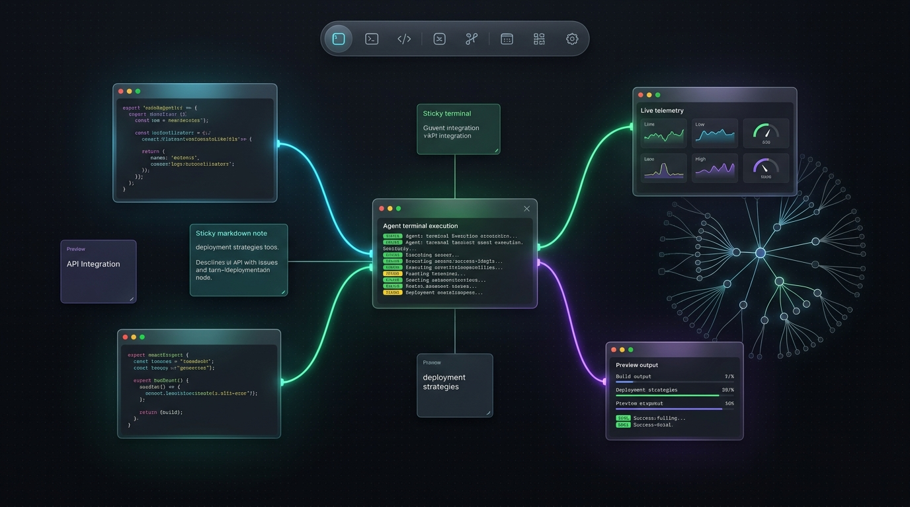
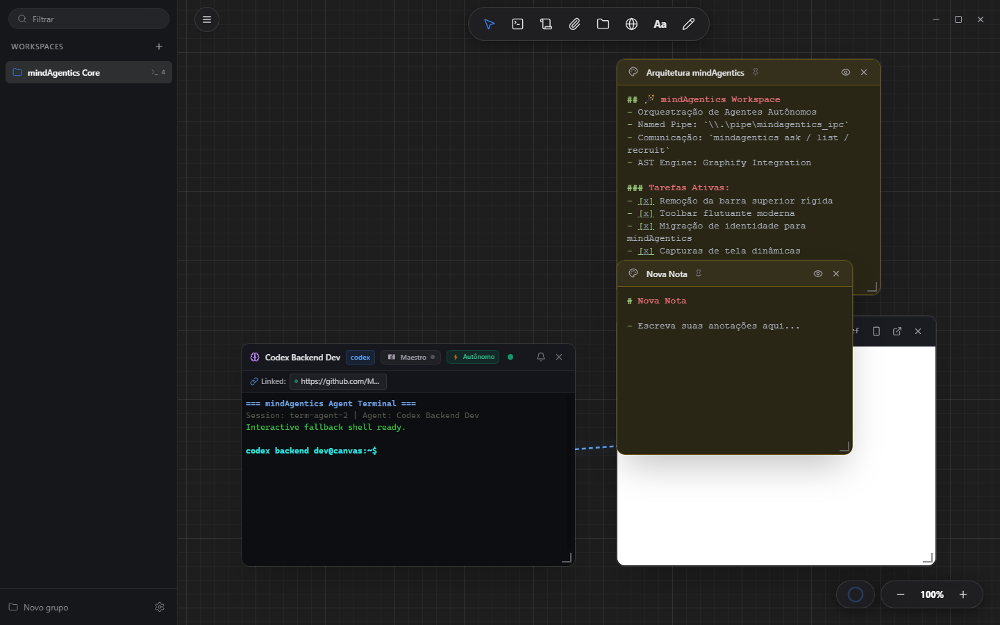
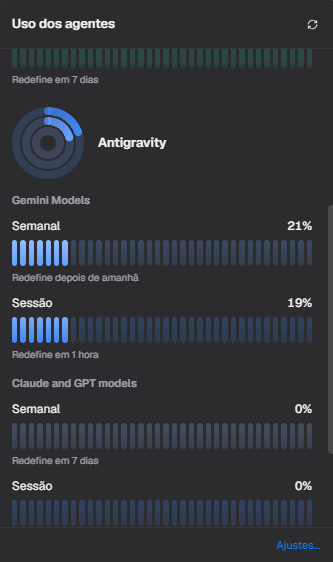
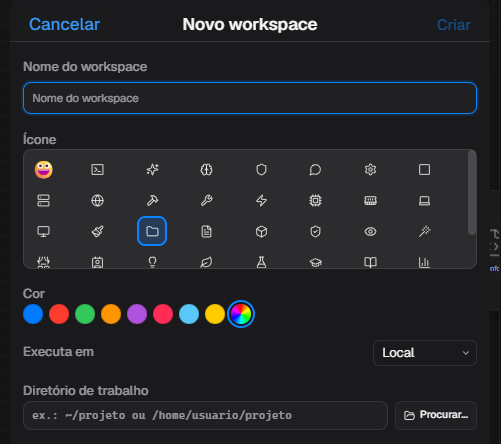

<div align="center">

# 🪄 mindAgentics

### *Spatial AI Development Workspace & Infinite Agent Canvas*

[](https://www.typescriptlang.org/)
[](https://react.dev/)
[](https://v2.tauri.app/)
[](https://www.rust-lang.org/)
[](https://tailwindcss.com/)
[](https://jotai.org/)
[](LICENSE)
[](https://github.com/MarcoBruschi/mindAgentics)

<br/>

**[English](README.md) | [Português](README.pt-BR.md)**

<br/>



<p align="center">
  <b>mindAgentics</b> is a 2D infinite spatial canvas development workspace where software engineers and multiple autonomous AI agents collaborate in real time. It seamlessly brings together native terminal emulators, dynamic markdown sticky notes, catenary physics-simulated connection cables, interactive web browser portals, and deterministic codebase knowledge graphs (Graphify).
</p>

[Overview](#-overview) •
[Visual Tour & Features](#-visual-tour--features) •
[CLI & Orchestrator Mode](#-cli--orchestrator-mode) •
[Technical Architecture](#-technical-architecture) •
[Quickstart Guide](#-quickstart-guide) •
[Keyboard Shortcuts](#-keyboard-shortcuts) •
[Community & Governance](#-community--governance)

---

</div>

## 🌟 Overview

Unlike traditional IDEs confined to rigid tab layouts and isolated terminal windows, **mindAgentics** unifies the software development lifecycle into an intuitive, high-performance spatial workspace:

- **Multimodal Agent Orchestration**: Run coding agents—such as Claude Code, Codex, Antigravity (`agy`), OpenCode, and custom shells—side by side in dedicated terminal nodes.
- **Inter-Agent Communication via Named Pipes**: Link nodes using network connection cables with 21-point catenary gravitational physics simulation over Windows Named Pipes (`\\.\pipe\mindagentics_ipc`).
- **In-Canvas Browser Portals**: Embed lightweight Chromium instances directly into nodes, enabling agents to browse documentation, inspect accessibility trees (`@e1`, `@e2`), and execute end-to-end tests without context switching.
- **Deterministic Knowledge Graph (Graphify)**: Extract complete codebase Abstract Syntax Trees (AST) into interactive force-directed graphs directly navigable on the canvas.
- **Workspace & Floor Isolation**: Manage parallel feature branches and independent tasks safely using native Git Worktrees.

---

## 📸 Visual Tour & Features

### 1. Infinite Spatial Canvas & Inter-Agent Cables
> *High-performance infinite 2D canvas with ultra-smooth panning, 10% to 300% zoom, marquee selection, and dynamic physics-based cables connecting terminals and notes.*

<div align="center">
  
</div>

- **Catenary Gravitational Physics**: Cable connections dynamically simulate real-world gravitational sag and curvature calculated between node connection ports.
- **Intelligent Spatial Layout**: DAG-based auto-layout and a 20px magnetic snap grid keep multi-agent topologies organized and legible.

---

### 2. Rapid Agent Creation & Specialized Presets
> *One-click agent launcher with curated presets, customizable themes, activity notifications, and Orchestrator Mode.*

<div align="center">
  
</div>

- **Turnkey Agent Presets**: Instant configuration templates for `Claude Code`, `Codex`, `Antigravity`, `OpenCode`, and `Generic Shell`.
- **Orchestrator Mode**: Designate terminal agents as Tech Leads capable of recruiting new specialists, decomposing objectives, and delegating work across the canvas.
- **Activity Monitoring**: Audio alerts and visual pulse indicators automatically notify you when long-running agent tasks complete.

---

### 3. Markdown Notes & Multi-Tab Binders
> *Living documentation, scratchpads, and multi-tab binders rendered with syntax highlighting and fully accessible to agent CLI tools.*

<div align="center">
  
</div>

- **Rich Markdown with CodeMirror 6**: Live syntax highlighting, checklists, Mermaid diagrams, code fences, and clickable links.
- **Multi-Tab Binders**: Consolidate technical specs, implementation plans, and debugging logs into a single modular canvas node.
- **Programmatic Interactivity**: Any connected agent can read, write, and append to notes in real time using `mindagentics note write`.

---

### 4. Browser Portals & Web Navigation
> *Chromium-powered web portals operating inside spatial canvas nodes, inspectable and automatable by autonomous agents.*

<div align="center">
  
</div>

- **Background Autonomous Browsing**: Agents open official documentation, query reference architectures, and verify deployed endpoints.
- **Accessibility Tree Inspection**: Generates unique element IDs (`@e1`, `@e2`, etc.) allowing agents to click, fill forms, and assert UI state deterministically.

---

### 5. Agent Limits & Quota Telemetry
> *Real-time quota monitoring radar displaying weekly and per-session capacity rings for configured AI models.*

<div align="center">
  
</div>

- **Multi-Model Tracking**: Monitor usage across Gemini (Antigravity), Anthropic Claude, and OpenAI GPT models.
- **Reset Timers**: Real-time estimations for rate-limit resets and token budget replenishments.

---

### 6. Multidimensional Workspace Management
> *Switch effortlessly between distinct projects and codebases with isolated working directories, custom color badges, and dedicated icons.*

<div align="center">
  
</div>

---

## ⚡ CLI & Orchestrator Mode

Every terminal spawned within **mindAgentics** automatically inherits environment variables (`MINDAGENTICS_PIPE`, `MINDAGENTICS_TERMINAL_ID`, etc.) providing direct zero-config access to the `mindagentics` CLI:

```bash
# List all active nodes, agents, notes, binders, and portals on the canvas
mindagentics list

# Send a direct instruction to another agent on the team
mindagentics ask "Backend Dev" "Create the POST /api/v1/auth route with Zod schema validation"

# Dynamically recruit a new specialist agent into the canvas workspace
mindagentics recruit "QA Bot" --preset "Codex" --role "Vitest & Integration Test Specialist"

# Open a web portal with documentation and connect it to an agent via cable tie
mindagentics portal open "https://tailwindcss.com/docs" --name "Tailwind Docs"
mindagentics connect "Frontend Dev" "Tailwind Docs"

# Create or overwrite documentation sticky notes with 100% fidelity
mindagentics note write "Architecture Decisions" --body "Adopted Repository pattern to decouple data layer."

# Run deterministic AST codebase analysis with Graphify
mindagentics graphify build .
mindagentics graphify query "Where is the PTY connection manager implemented?"
mindagentics graphify open
```

---

## 🏗️ Technical Architecture

The codebase is organized as a modular monorepo combining native Rust for systems-level performance and TypeScript/React for rapid UI iteration:

```
mindAgentics/
├── src-tauri/             # Native Rust core (Tauri v2): ConPTY, Named Pipes, Storage Engine, Git Worktrees, DWM Acrylic
├── packages/
│   ├── shared/            # TypeScript data models, node contracts, and IPC channels
│   ├── public-api/        # mindAgentics SDK and public command API
│   ├── core-daemon/       # Message routing server, Named Pipe server, and CLI dispatcher
│   └── renderer/          # Infinite Canvas React 19 + Vite + Tailwind application
├── skills/                # Agent skills (mindAgentics, Graphify, Portal, Routines)
├── docs/                  # Technical documentation, IPC matrices, and system screenshots
└── package.json           # Monorepo build, packaging, and orchestration scripts
```

### Technology Stack

| Layer | Technologies & Specifications |
| :--- | :--- |
| **Desktop Shell** | **Tauri v2** (100% native Rust high-performance desktop runtime) |
| **Native Core & System Engine** | Rust 2021 / 1.85+, Tokio async runtime, `portable-pty`, Win32 JobObjects, Windows Named Pipes |
| **Frontend Framework** | React 19, TypeScript 5.7, Vite 6 |
| **State Management** | Jotai 2.10 (Fine-grained reactive atomic state) |
| **Styling & Window Material** | Tailwind CSS 3.4, PostCSS, Windows 11 DWM Acrylic / Backdrop Blur (`#120F0E`) |
| **Terminal Emulation** | `@xterm/xterm`, native ConPTY via `portable-pty` |
| **Text & Code Editors** | CodeMirror 6, Mermaid.js diagramming engine |
| **IPC & Communication** | Windows Named Pipes (`\\.\pipe\*`), Tauri v2 binary channels & universal IPC dispatcher |
| **Knowledge Graph Engine** | Graphify (Deterministic AST parser in Python / Rust fallback + D3.js force-directed layout) |

---

## 🚀 Quickstart Guide

### Prerequisites

- **Node.js** >= `20.x` (Recommended: `22.x` or later)
- **npm** >= `10.x`
- **Rust** >= `1.85+` *(Required to compile the Tauri v2 native core)*
- **Python** >= `3.10` *(Required for the Graphify AST knowledge graph engine)*
- **Git**

### 1. Clone the Repository

```bash
git clone https://github.com/MarcoBruschi/mindAgentics.git
cd mindAgentics
```

### 2. Install Dependencies & Verify Environment

```bash
npm install
npm run doctor
npm run setup:graphify
```

### 3. Build Monorepo Packages

```bash
npm run build
```

*Or build only the renderer package during active UI development:*
```bash
npm run build:renderer
```

### 4. Launch the Application

```bash
# Run in development mode with hot-reloading
npm run tauri:dev

# Or alternatively:
npm start
```

*To create an optimized production executable installer:*
```bash
npm run tauri:build
```

*To regenerate high-resolution documentation screenshots automatically (Edge Headless + Selenium):*
```bash
npm run screenshots:capture
```

---

## ⌨️ Keyboard Shortcuts

| Key / Combination | Canvas Action |
| :--- | :--- |
| `Space` + Drag | Pan Canvas |
| `V` | Switch to Pointer / Selection Tool |
| `C` | Switch to Cable Connection Mode |
| `D` | Switch to Freehand Drawing (Pen) |
| `E` | Switch to Drawing Eraser |
| `Ctrl` + `T` | Open Agent / Terminal Creation Modal |
| `Ctrl` + `Shift` + `T` | Add Floating Text Block to Canvas |
| `Ctrl` + `N` | Create New Sticky Note |
| `Ctrl` + `S` | Toggle Workspace Sidebar Visibility |
| `Ctrl` + `F` | Open Command Palette / Global Search |
| `Ctrl` + `0` | Reset Canvas Zoom to 100% |
| `Ctrl` + `Z` | Undo Last Action |
| `Ctrl` + `Y` / `Ctrl` + `Shift` + `Z` | Redo Last Action |
| `Delete` / `Backspace` | Delete Selected Nodes or Cable Connections |

---

## 🤝 Community & Governance

We welcome contributions from developers and AI engineers around the world! Explore the following resources to get started:

- **[Contributing Guide](CONTRIBUTING.md)**: Code style standards, branch workflows, and PR submission guidelines.
- **[Code of Conduct](CODE_OF_CONDUCT.md)**: Our expectations for a welcoming, safe, and collaborative community.
- **[Security Policy](SECURITY.md)**: Procedures for reporting vulnerabilities responsibly.
- **[MIT License](LICENSE)**: Legal terms regarding software usage and distribution.

---

<div align="center">
  <sub>Engineered with precision for human developers and autonomous AI agents by mindAgentics.</sub>
</div>
