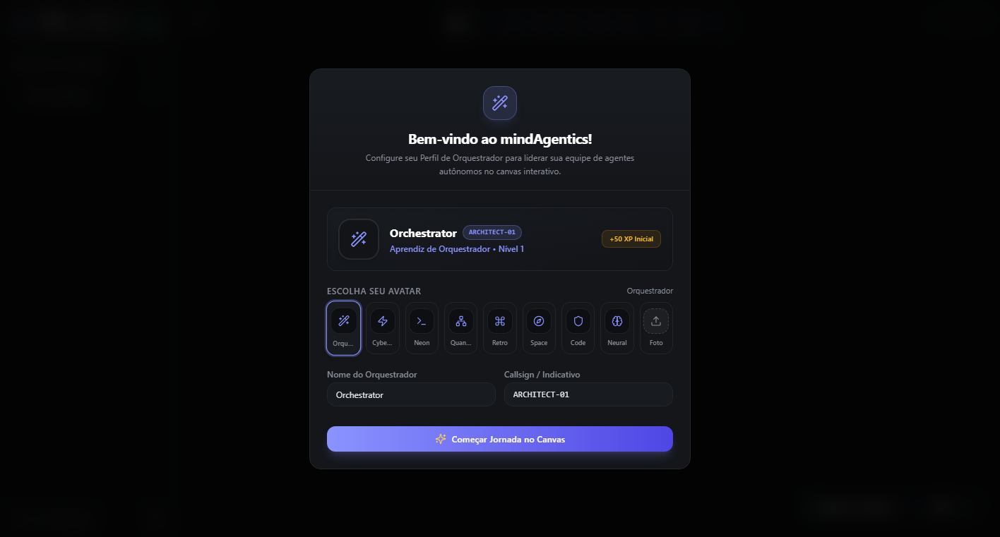
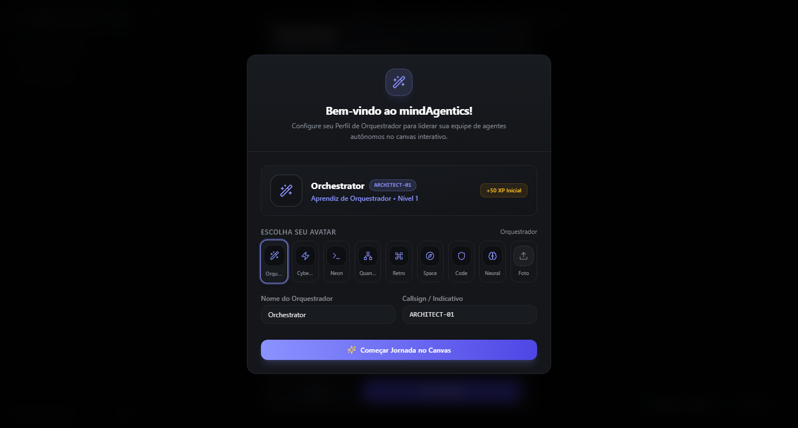
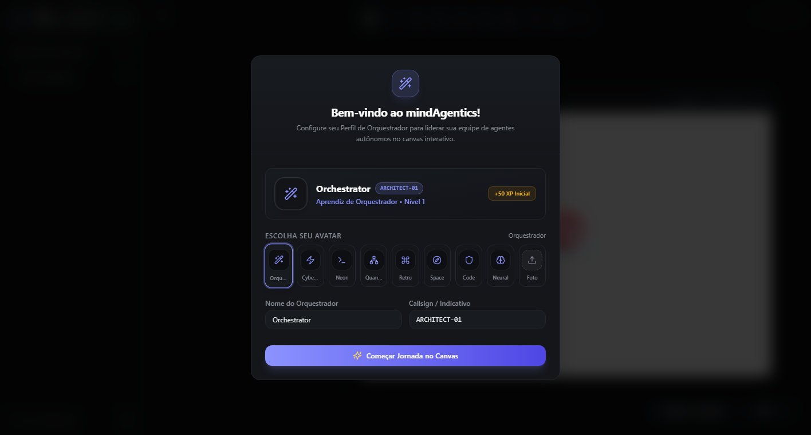

<div align="center">

# 🪄 mindAgentics

### *Spatial AI Development Workspace & Infinite Agent Canvas*

[](https://www.typescriptlang.org/)
[](https://react.dev/)
[](https://v2.tauri.app/)
[](https://www.rust-lang.org/)
[](https://tailwindcss.com/)
[](https://jotai.org/)
[](https://github.com/MarcoBruschi/mindAgentics)

<br/>


<p align="center">
  <b>mindAgentics</b> é uma plataforma espacial de desenvolvimento em tela infinita 2D onde engenheiros de software e múltiplos agentes de IA autônomos colaboram em tempo real. Integra emuladores de terminal nativos, notas markdown dinâmicas, cabos de conexão com física catenária, portais web interativos e grafos determinísticos de conhecimento de código (Graphify).
</p>

[Visão Geral](#-visão-geral) •
[Demonstração & Funcionalidades](#-demonstração--funcionalidades) •
[CLI & Modo Orquestrador](#-cli--modo-orquestrador) •
[Arquitetura do Monorepo](#-arquitetura-do-monorepo) •
[Instalação & Execução](#-instalação--execução) •
[Atalhos de Teclado](#-atalhos-de-teclado)

---

</div>

## 🌟 Visão Geral

Ao contrário dos ambientes de desenvolvimento tradicionais baseados em abas isoladas, o **mindAgentics** unifica a esteira de desenvolvimento em uma topologia espacial dinâmica:

- **Orquestração Multimodal de Agentes**: Execute agentes como Claude Code, Codex, Antigravity (`agy`), OpenCode e shells genéricos simultaneamente lado a lado.
- **Comunicação Inter-Agentes via Named Pipes**: Conecte nós através de cabos de rede com simulação gravitacional de física catenária de 21 pontos (`\\.\pipe\mindagentics_ipc`).
- **Navegação Web com Browser Portals**: Instâncias embutidas de Chromium permitindo que agentes naveguem, inspecionem elementos da árvore de acessibilidade (`@e1`, `@e2`) e executem testes ponta a ponta.
- **Knowledge Graph Determinístico (Graphify)**: Extração de AST de repositórios completos em grafos interativos de força direcionada navegáveis diretamente no canvas.
- **Isolamento de Workspaces & Floors**: Separação de branches e tarefas paralelas utilizando Git Worktrees nativos.

---

## 📸 Demonstração & Funcionalidades

### 1. Canvas Espacial Infinito & Cabos Inter-Agentes
> *Canvas infinito de alta performance com suporte a pan suave, zoom de 10% a 300%, seleção por área (marquee) e cabos físicos dinâmicos conectando terminais e notas.*

<div align="center">
  
</div>

- **Física Gravitacional Catenária**: Cabos de conexão calculados dinamicamente com curvatura baseada na distância relativa entre as portas dos nós.
- **Organização Inteligente**: Alinhamento automático baseado em DAG e grade magnética de precisão (20px).

---

### 2. Criação Rápida de Agentes & Perfis Especializados
> *Templates instantâneos prontos para os principais agentes de codificação do mercado, com customização visual, detecção de conclusão de tarefas e modo Orquestrador.*

<div align="center">
  
</div>

- **Presets Nativos**: Inicialização com 1 clique para `Claude Code`, `Codex`, `Antigravity`, `OpenCode` e `Generic Shell`.
- **Modo Orquestrador**: Promove terminais a orquestradores capazes de recrutar novos agentes, dividir tarefas complexas e reger o restante da equipe no canvas.
- **Monitoramento de Atividade**: Notificações automáticas via som e sinalizador de status assim que uma rotina do agente finaliza.

---

### 3. Fichários e Notas Adesivas Markdown
> *Documentação viva e cadernos com abas múltiplas (Fichário) editáveis em tempo real e sincronizados com a CLI dos agentes.*

<div align="center">
  
</div>

- **Markdown Rico com CodeMirror 6**: Edição transparente com destaque de sintaxe, checklists, links e suporte a blocos de código.
- **Abas Laterais em Fichários**: Agrupamento modular de documentações técnicas, especificações e logs de experimentos no mesmo nó.
- **Manipulação Programática**: Qualquer agente conectado pode ler e escrever notas utilizando `mindagentics note write`.

---

### 4. Browser Portals & Navegação Web no Canvas
> *Instâncias de navegador Chromium operando diretamente dentro de nós espaciais, inspecionáveis e automatizáveis pelos agentes.*

<div align="center">
  
</div>

- **Automação Sem Foco**: Agentes podem abrir documentações, navegar em links de teste e analisar interfaces em background.
- **Árvore de Acessibilidade**: Extração de elementos interativos com identificadores acessíveis (`@e1`, `@e2`, etc.) para cliques determinísticos.

---

### 5. Telemetria e Monitoramento de Quota de Agentes
> *Radar em tempo real com anéis de uso de quota semanal e de sessão para os modelos conectados.*

<div align="center">
  
</div>

- **Rastreamento de Modelos**: Quotas de Gemini (Antigravity), Claude e OpenAI GPT.
- **Previsão de Reset**: Estimativa de tempo restante para redefinição de limites de requisições e tokens.

---

### 6. Gestão Multidimensional de Workspaces
> *Alterne instantaneamente entre múltiplos projetos com diretórios de trabalho isolados, paletas de cores personalizadas e ícones dedicados.*

<div align="center">
  
</div>

---

## ⚡ CLI & Modo Orquestrador

Todos os agentes em execução no terminal recebem variáveis de ambiente (`MINDAGENTICS_PIPE`, `MINDAGENTICS_TERMINAL_ID`, etc.) que fornecem acesso imediato à CLI do **mindAgentics** (`mindagentics`):

```bash
# Listar todos os nós, agentes, notas e portais ativos no canvas
mindagentics list

# Enviar instrução direta para outro agente na equipe
mindagentics ask "Backend Dev" "Crie a rota POST /api/v1/auth com validação Zod"

# Recrutar dinamicamente um novo especialista no canvas
mindagentics recruit "QA Bot" --preset "Codex" --role "Especialista em Testes Vitest"

# Abrir um portal web com a documentação oficial e conectar ao agente
mindagentics portal open "https://tailwindcss.com/docs" --name "Tailwind Docs"
mindagentics connect "Frontend Dev" "Tailwind Docs"

# Escrever ou atualizar notas adesivas de documentação
mindagentics note write "Decisões de Arquitetura" --body "Adotado padrão Repository para desacoplar a camada de dados."

# Executar análise determinística de Knowledge Graph
mindagentics graphify build .
mindagentics graphify query "Onde está implementado o gerenciador de conexões PTY?"
mindagentics graphify open
```

---

## 🏗️ Arquitetura do Monorepo

O projeto é estruturado em um monorepo modular combinando TypeScript e Rust:

```
mindAgentics/
├── src-tauri/             # Core nativo em Rust (Tauri v2): PTY ConPTY, Named Pipes, Storage Engine, Git Worktrees, DWM Acrylic
├── packages/
│   ├── shared/            # Modelos de dados TypeScript, contratos de nós e canais IPC
│   ├── public-api/        # SDK e API pública de comandos do mindAgentics
│   ├── core-daemon/       # Servidor de roteamento de mensagens, Named Pipe e CLI dispatcher
│   └── renderer/          # Aplicação React 19 + Vite + Tailwind do Canvas Infinito
├── skills/                # Habilidades dos agentes (mindAgentics, Graphify, Portal, Routines)
├── docs/                  # Documentações técnicas, matriz de IPC e capturas de tela do sistema
└── package.json           # Scripts de build, empacotamento e orquestração do monorepo
```

### Tecnologias Utilizadas

| Camada | Tecnologias |
| :--- | :--- |
| **Desktop Shell Principal** | **Tauri v2** (Rust nativo de alta performance) |
| **Core & Engine Nativa** | Rust 2021, Tokio, `portable-pty`, Win32 JobObjects, Windows Named Pipes |
| **Frontend Framework** | React 19, TypeScript 5.7, Vite 6 |
| **Gerenciamento de Estado** | Jotai (Atoms atômicos e reativos) |
| **Estilização & Material** | Tailwind CSS 3.4, PostCSS, Windows 11 DWM Acrylic / Backdrop Blur (`#120F0E`) |
| **Terminais** | `@xterm/xterm`, ConPTY nativo via `portable-pty` |
| **Editores de Texto** | CodeMirror 6, Mermaid.js |
| **Transporte IPC** | Windows Named Pipes (`\\.\pipe\*`), Tauri v2 Binary Channels & IPC Dispatcher universal |
| **Engine de Grafo** | Graphify (AST determinístico em Python / Rust Fallback + D3.js Force Layout) |

---

## 🚀 Instalação & Execução

### Pré-requisitos

- **Node.js** >= `20.x` (Recomendado 22.x ou superior)
- **npm** >= `10.x`
- **Rust** >= `1.85+` *(Necessário para compilar o core Tauri v2)*
- **Python** >= `3.10` *(Obrigatório apenas para o engine do Graphify)*
- **Git**

### 1. Clonar o Repositório

```bash
git clone https://github.com/MarcoBruschi/mindAgentics.git
cd mindAgentics
```

### 2. Instalar Dependências

```bash
npm install
npm run setup:graphify
```

### 3. Compilar Todos os Pacotes

```bash
npm run build
```

*Ou compile apenas o pacote do renderer em desenvolvimento:*
```bash
npm run build:renderer
```

### 4. Iniciar a Aplicação

```bash
npm start
# ou diretamente:
npm run tauri:dev
```

*Para compilar o pacote executável standalone em produção:*
```bash
npm run tauri:build
```

*Para atualizar automaticamente as capturas de tela oficiais da documentação (Edge Headless + Selenium):*
```bash
npm run screenshots:capture
```

---

## ⌨️ Atalhos de Teclado

| Tecla / Combinação | Ação no Canvas |
| :--- | :--- |
| `Espaço` + Arrastar | Mover tela (Pan no Canvas) |
| `V` | Ativar ferramenta de Seleção |
| `C` | Ativar modo de Conexão com Cabos |
| `D` | Ativar modo de Desenho Livre (Caneta) |
| `E` | Ativar Borracha de Desenho |
| `Ctrl` + `T` | Abrir Modal de Criação de Agente / Terminal |
| `Ctrl` + `Shift` + `T` | Adicionar Bloco de Texto solto no Canvas |
| `Ctrl` + `N` | Criar nova Nota Adesiva |
| `Ctrl` + `S` | Alternar exibição da Barra Lateral de Workspaces |
| `Ctrl` + `F` | Abrir Paleta de Comandos / Busca Global |
| `Ctrl` + `0` | Redefinir Zoom para 100% |
| `Ctrl` + `Z` | Desfazer última ação |
| `Ctrl` + `Y` / `Ctrl` + `Shift` + `Z` | Refazer última ação |
| `Delete` / `Backspace` | Excluir nós ou conexões selecionadas |

---

## 📄 Licença

Este projeto é desenvolvido para uso em ambientes de engenharia de software aumentada por IA. Consulte o arquivo [LICENSE](LICENSE) para maiores detalhes sobre os termos de uso.

<div align="center">
  <sub>Construído com excelência para desenvolvedores e agentes autônomos por mindAgentics.</sub>
</div>
